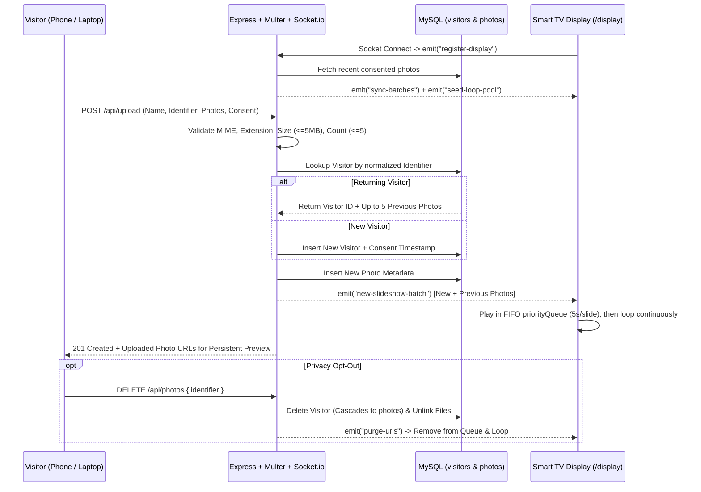

# System Architecture

## 1. Tech Stack & Rationale
* **Frontend (`HTML5`, `CSS3`, `Vanilla JS`, `Canvas`):** Lightweight with zero build-step overhead, running smoothly on smart TV browsers and smartphones. Includes frosted glassmorphism, drag-and-drop previews, and an interactive particle background.
* **Backend (`Node.js` + `Express.js`):** Non-blocking event-driven I/O handles concurrent `multipart/form-data` image uploads efficiently.
* **Real-Time Communication (`Socket.io`):** Enables instant photo broadcasting (`new-slideshow-batch`), display registration sync (`register-display`), instant deletion purging (`purge-urls`), and live reactions (`live-reaction`).
* **Database (`MySQL` via `mysql2/promise`):** Relational schema maps each `visitor` to their `photos` with `ON DELETE CASCADE` for clean privacy opt-outs.
* **File Validation & QR Utilities (`Multer` + `QRCode`):** Multer enforces MIME, extension, count, and 5 MB size limits; `qrcode` generates Wi-Fi IP QR codes for phone access.

## 2. Database Data Model

### `visitors` Table
| Column | Type | Constraints | Description |
| :--- | :--- | :--- | :--- |
| `id` | `INT` | `PRIMARY KEY, AUTO_INCREMENT` | Unique visitor ID |
| `name` | `VARCHAR(100)` | `NOT NULL` | Visitor display name |
| `identifier` | `VARCHAR(150)` | `NOT NULL, UNIQUE` | Normalized email or phone number |
| `consent_given` | `BOOLEAN` | `NOT NULL, DEFAULT TRUE` | Public display consent flag |
| `consent_timestamp` | `DATETIME` | `NOT NULL` | Timestamp when consent was recorded |
| `created_at` | `TIMESTAMP` | `DEFAULT CURRENT_TIMESTAMP` | First visit timestamp |

### `photos` Table
| Column | Type | Constraints | Description |
| :--- | :--- | :--- | :--- |
| `id` | `INT` | `PRIMARY KEY, AUTO_INCREMENT` | Unique photo ID |
| `visitor_id` | `INT` | `FOREIGN KEY -> visitors(id) ON DELETE CASCADE` | Owner visitor reference |
| `filename` | `VARCHAR(255)` | `NOT NULL` | Unique generated filename in `uploads/` |
| `original_name` | `VARCHAR(255)` | `NOT NULL` | Original uploaded filename |
| `mime_type` | `VARCHAR(50)` | `NOT NULL` | Validated MIME type (`image/jpeg`, `png`, `webp`) |
| `size_bytes` | `INT` | `NOT NULL` | File size in bytes (max 5 MB) |
| `uploaded_at` | `TIMESTAMP` | `DEFAULT CURRENT_TIMESTAMP` | Upload timestamp |

## 3. System Flow Diagram

