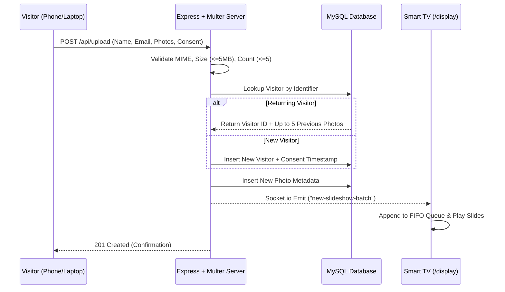

# System Architecture

## Tech Stack & Rationale
* **Frontend (HTML/CSS/JS):** Lightweight, zero build-step overhead, runs reliably on any smart TV browser or mobile device.
* **Backend (Node.js + Express):** Non-blocking I/O handles concurrent multipart file uploads efficiently.
* **Real-Time (Socket.io):** Pushes newly uploaded photo batches to `/display` instantly without polling or page refreshes.
* **Database (MySQL):** Relational schema cleanly maps one `visitor` to many `photos` with `ON DELETE CASCADE` for privacy opt-outs.
* **File Handling (Multer):** Enforces file size, count, and MIME-type limits before files hit disk.

## Data Model
* **`visitors`**: `id (PK)`, `name`, `identifier (UNIQUE)`, `consent_given`, `consent_timestamp`, `created_at`
* **`photos`**: `id (PK)`, `visitor_id (FK -> visitors.id)`, `filename`, `original_name`, `mime_type`, `size_bytes`, `uploaded_at`

## Architecture Diagram

