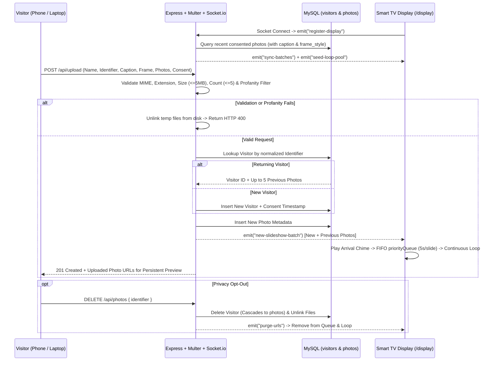

# System Architecture

## 1. Tech Stack & Rationale
* **Frontend (`HTML5`, `CSS3`, `Vanilla JS`, `Canvas`, `Web Audio API`):** Zero build-step overhead so it runs smoothly on any smart TV browser or mobile device. Includes frosted glassmorphism, four selectable photo frame styles, an interactive 60fps particle canvas, host keyboard shortcuts, and synthesized arrival chimes without external audio files.
* **Backend (`Node.js` + `Express.js`):** Non-blocking event-driven I/O handles concurrent `multipart/form-data` uploads, server-side profanity filtering, and automatic schema migration.
* **Real-Time Transport (`Socket.io`):** Enables instant photo batch broadcasting (`new-slideshow-batch`), order-independent TV handshake synchronization (`register-display`), instant deletion purges (`purge-urls`), and live emoji reactions (`live-reaction`).
* **Database (`MySQL` via `mysql2/promise`):** Relational schema maps each `visitor` to their `photos` (including `caption` and `frame_style`) with `ON DELETE CASCADE` for clean privacy opt-outs.
* **File & QR Utilities (`Multer` + `QRCode`):** Multer enforces MIME type, file extension, batch count, and 5 MB size limits; `qrcode` detects the host's local Wi-Fi IPv4 address to generate scannable QR codes.

## 2. Relational Data Model

### `visitors` Table
| Column | Type | Constraints | Description |
| :--- | :--- | :--- | :--- |
| `id` | `INT` | `PRIMARY KEY, AUTO_INCREMENT` | Unique visitor ID |
| `name` | `VARCHAR(100)` | `NOT NULL` | Display name shown on TV overlay |
| `identifier` | `VARCHAR(150)` | `NOT NULL, UNIQUE` | Normalized (trimmed, lowercased) email or phone |
| `consent_given` | `BOOLEAN` | `NOT NULL, DEFAULT TRUE` | Explicit public display consent flag |
| `consent_timestamp` | `DATETIME` | `NOT NULL` | Audit timestamp when consent was recorded |
| `created_at` | `TIMESTAMP` | `DEFAULT CURRENT_TIMESTAMP` | First visit timestamp |

### `photos` Table
| Column | Type | Constraints | Description |
| :--- | :--- | :--- | :--- |
| `id` | `INT` | `PRIMARY KEY, AUTO_INCREMENT` | Unique photo ID |
| `visitor_id` | `INT` | `FOREIGN KEY -> visitors(id) ON DELETE CASCADE` | Owner visitor reference |
| `filename` | `VARCHAR(255)` | `NOT NULL` | Unique generated filename stored in `uploads/` |
| `original_name` | `VARCHAR(255)` | `NOT NULL` | Original uploaded filename |
| `mime_type` | `VARCHAR(50)` | `NOT NULL` | Validated MIME type (`image/jpeg`, `png`, `webp`) |
| `size_bytes` | `INT` | `NOT NULL` | File size in bytes (max 5,242,880) |
| `caption` | `VARCHAR(100)` | `DEFAULT NULL` | Optional profanity-filtered shoutout caption |
| `frame_style` | `VARCHAR(20)` | `NOT NULL, DEFAULT 'glass'` | Selected frame (`glass`, `polaroid`, `warm`, `noir`) |
| `uploaded_at` | `TIMESTAMP` | `DEFAULT CURRENT_TIMESTAMP` | Upload timestamp |

## 3. End-to-End System Flow

